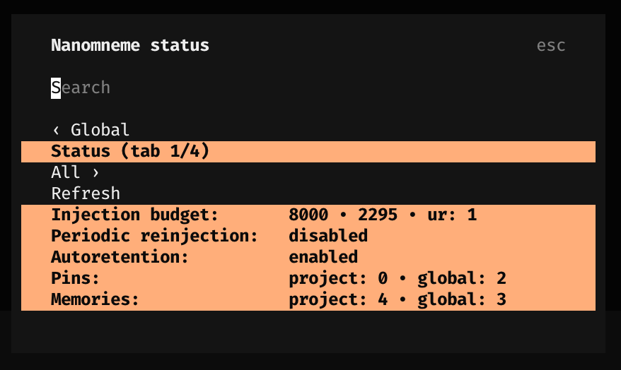
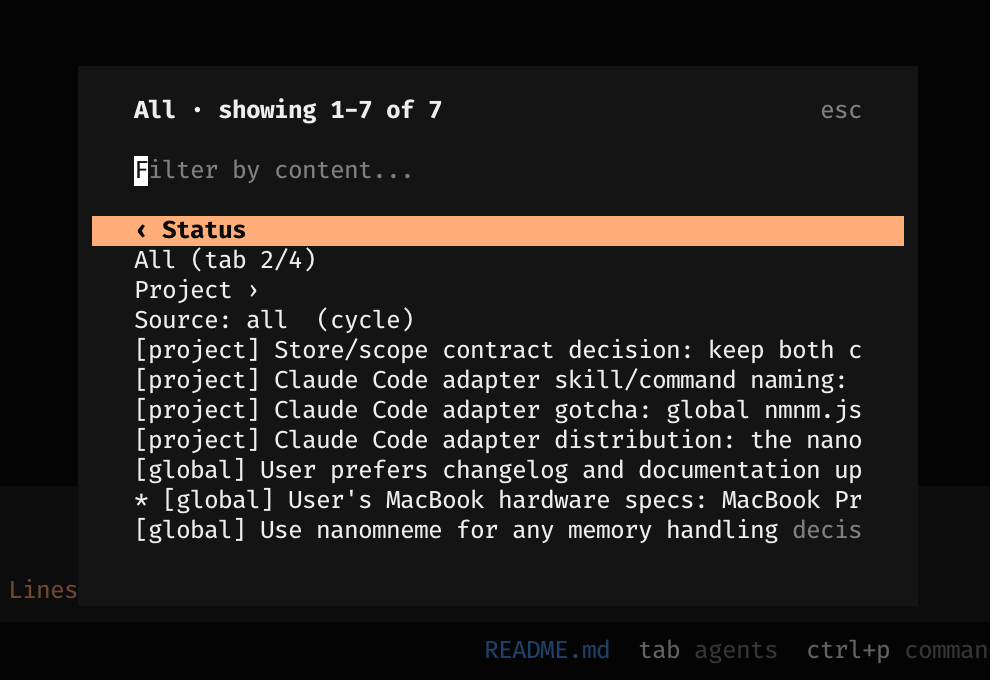
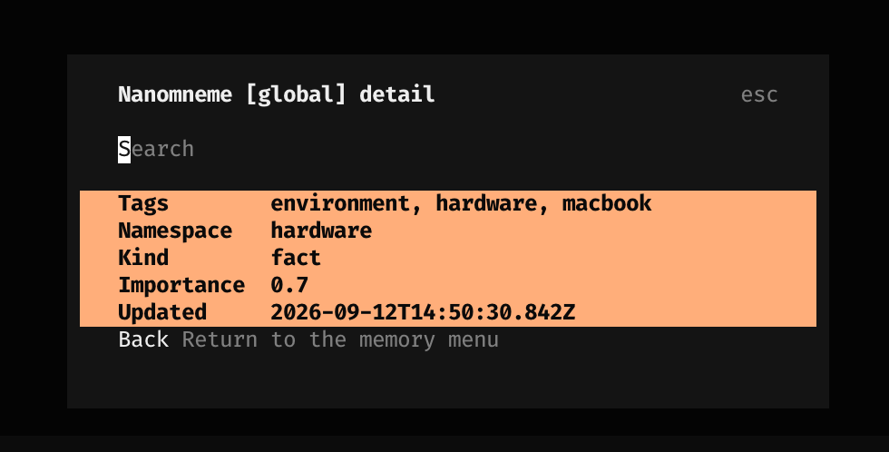

# @openlines/nmnm-opencode

Version 0.3.0 supports native baselines OpenCode V1 1.19.0 and V2 2.0.29. Checkout and independently installed-package checks cover both terminal browsers; live Bedrock Haiku 5.5 verifies V2 context, recall continuation, and post-compaction freshness. Node 22.19.0 and 26.11.1 are verified. Remote-machine deployment and publication remain separate.

<div align="center">

[](https://www.npmjs.com/package/@openlines/nmnm-opencode) [](https://www.npmjs.com/package/@openlines/nmnm-opencode)

</div>

OpenCode adapter for [nanomneme](https://github.com/linellazatin/nanomneme): a server plugin that gives OpenCode native, observable memory tools backed by the shared nanomneme SQLite store, bounded transient memory-index injection during the session, and a model-free TUI memory browser. Memory is reusable across OpenCode, Pi, Claude Code, and other adapters; only the harness-facing surface differs.

## What it provides

- A native **server plugin** (`index.js`, delegating to `src/server-v1.js` or `src/server-v2.js`) registers `retain_memory`, `recall_memory`, `retrieve_memory`, and `remove_memory`. Bun-hosted calls use the short-lived Node bridge (`src/bridge.js`) for SQLite access. No additional MCP server or daemon is introduced. New retains record `metadata.source: "opencode"`; patches preserve existing source when metadata is omitted. Only retain creates missing stores. Removal is soft; purge requires the core CLI or workbench.
- **Bounded transient injection:** optional autoretention guidance precedes pins and recent memories. V1 uses `experimental.chat.system.transform`; V2 uses the primary session context hook, resolving the session directory each time. V2 auxiliary title/generate/compaction requests have no additional memory hook. The next primary request receives a fresh index. `reinjection` stays inert; context is never persisted.
- A deterministic, model-free **management CLI** — `nmnm-opencode` (`status`, `list`, `search`, `show`, `pin`, `unpin`, `remove`).
- A model-free **terminal browser** on **ctrl+alt+m** provides Status/All/Project/Global, source cycling, pagination, pin/unpin, and confirmed soft removal. V1 uses a terminal-local bridge; V2 uses authenticated OpenCode RPC and the server's home/store paths. Location changes reject stale selections rather than mutating a different store.







## Install

Use Node.js 22.19+ with built-in SQLite/FTS5 on the server's `PATH` (or `NMNM_NODE`). The unchanged package engine floor is 22.13 with FTS5 required separately, but the tested stock 22.13.0 binary lacks FTS5 and is unsuitable. The complete adapter suite passes on 22.19.0 and 26.11.1. Tested hosts are V1 1.19.0 and V2 2.0.29, not every version accepted by the legacy API dependency. V1 receives compatibility fixes, not indefinite feature parity or an older-host guarantee.

### OpenCode V2

Configure the server in `opencode.json(c)`:

```jsonc
{ "$schema": "https://opencode.ai/config.json", "plugins": ["@openlines/nmnm-opencode@0.3.0"] }
```

OpenCode automatically loads the package's `./tui` entry from the connected server's plugin list. For an explicit terminal-local registration, use global `${XDG_CONFIG_HOME:-~/.config}/opencode/cli.json` with `{"plugins":["@openlines/nmnm-opencode@0.3.0"]}`; do not put terminal preferences in server configuration. Press **ctrl+alt+m**. Local development must use the adapter directory, such as `{"plugins":["/absolute/path/to/nanomneme/adapters/opencode"]}`, not `index.js` or `tui.js`. A remote server must have the server plugin enabled; the terminal browser never substitutes local persistence. Version 0.3.0 must be published separately before registry installation is available.

### OpenCode V1

Use singular `plugin` in the server configuration:

```jsonc
// opencode.json
{
  "$schema": "https://opencode.ai/config.json",
  "plugin": ["@openlines/nmnm-opencode@0.3.0"]
}
```

OpenCode installs npm plugins (and their dependencies) via Bun at startup and caches them.

### Enable the TUI browser

The TUI browser is a separate plugin entry from the server plugin. Register the same package in `~/.config/opencode/tui.jsonc`; OpenCode resolves the package's `./tui` export:

```jsonc
{ "plugin": ["@openlines/nmnm-opencode@0.3.0"] }
```

Restart OpenCode, then press **ctrl+alt+m** to open the model-free browser. It provides Status, All, Project, and Global tabs plus source filtering, pin/unpin, and confirmed soft removal.

For local development from this checkout, point the entry at the source instead:

```jsonc
{ "plugin": ["file:///absolute/path/to/nanomneme/adapters/opencode/index.js"] }
```

Register the TUI source separately in `~/.config/opencode/tui.jsonc`:

```jsonc
{ "plugin": ["file:///absolute/path/to/nanomneme/adapters/opencode/tui.js"] }
```

The four memory tools then appear natively to the agent. See the [OpenCode Adapter Manual](docs/OPENCODE_ADAPTER_MANUAL.md) for the full guide, including the compatibility probes and the manual smoke check.

To roll back a previously installed V1 integration, pin `@openlines/nmnm-opencode@0.2.2` in both V1 registrations and restart. That older adapter is not a V2 rollback option. V2 may disable this plugin through its existing plugin configuration; no store migration is required in either direction.

## Configuration

- Project settings (shared across adapters): `<repo>/.nanomneme/nmnm.jsonc`.
- Global settings: `${XDG_CONFIG_HOME:-~/.config}/opencode/nmnm.jsonc`.
- Pins (adapter-owned): `<repo>/.nanomneme/nmnm-opencode.json` and `~/.local/share/nanomneme/nmnm-opencode.json`.

See the [OpenCode Adapter Manual](docs/OPENCODE_ADAPTER_MANUAL.md) for the config schema, tool reference, and injection lifecycle.

## Develop

The browser RPC transport exposes only status, browse, detail, and pin/unpin/soft-removal operations through the connected OpenCode server. The server owns store routing and the Node bridge; the V2 client transport never falls back to local persistence. Transport failures are not retried automatically, and cancellation does not roll back a mutation already dispatched to the synchronous bridge. Native transport checks are opt-in: set `NMNM_OPENCODE_V1` or `NMNM_OPENCODE_V2` to the corresponding executable and run `node --test adapters/opencode/test/browser-rpc-v1-host.test.js` or `node --test adapters/opencode/test/browser-rpc-host.test.js`. Each creates isolated host state and disposable stores without using the personal background service; without the environment variable, that host check is explicitly skipped.

Core hardening introduced in `0.3.0` and retained in `0.3.1` is covered through the real Node bridge for Unicode search/validation, invalid metadata/range operators, and private project/global first-use storage; direct handlers cover monotonic patch/restore timestamps under frozen/backward clocks. Tool-handler APIs are unchanged. Export/import/verification remain core CLI operations, not adapter tools.

```sh
node --test adapters/opencode/test/*.test.js
```

## Shared opt-in diagnostics

Diagnostics default off. Enable shared `logging.enabled` in `~/.local/share/nanomneme/config.jsonc`. User-level adapter settings can override it. Raw error messages are not redacted. See the [Logger manual](../../docs/LOGGER.md#configuration-and-record-contract) for configuration, record fields, permissions, and privacy boundaries.

OpenCode uses its existing user settings resolver under the OpenCode config directory. Node tool operations, CLI mutations, and confirmed TUI mutations are observed; index/navigation reads are unlogged. Each bridge process resolves settings anew. Spawn failures emit one host-side failed record because the bridge never ran; ambiguous post-spawn transport/parse failures remain unlogged to avoid contradicting a bridge outcome. Server tools forward the host tool-context `sessionID`; TUI and CLI management use null correlation.

Pin mutations use a same-directory lock and atomic replacement. Competing writers receive a retry error; locks are never reclaimed automatically. After a crash, stop all adapter writers, remove the affected pin file’s `.lock` manually, then retry.

`src/logslines.js` binds this adapter to core’s shared logging runtime; it does not contain a separate observer or generated bundle. See the [Logger manual](../../docs/LOGGER.md#source-and-artifact-map) for file roles and build rules.
