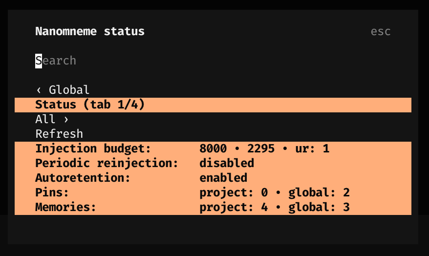
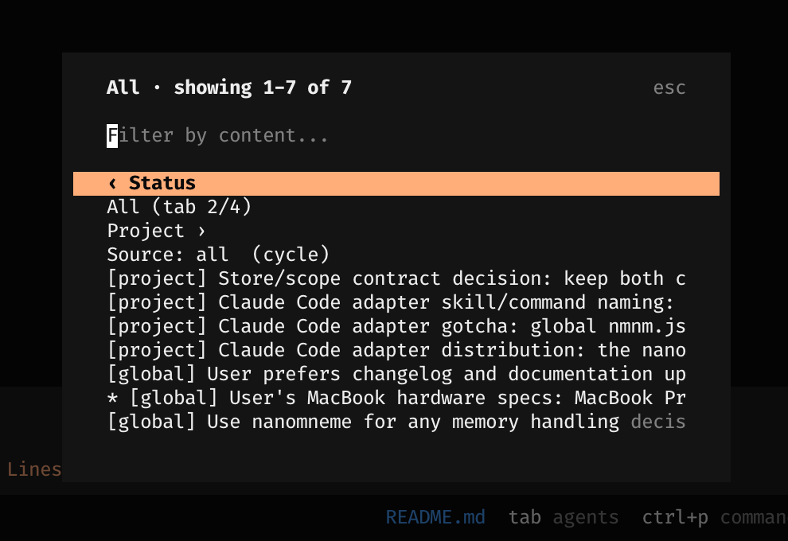
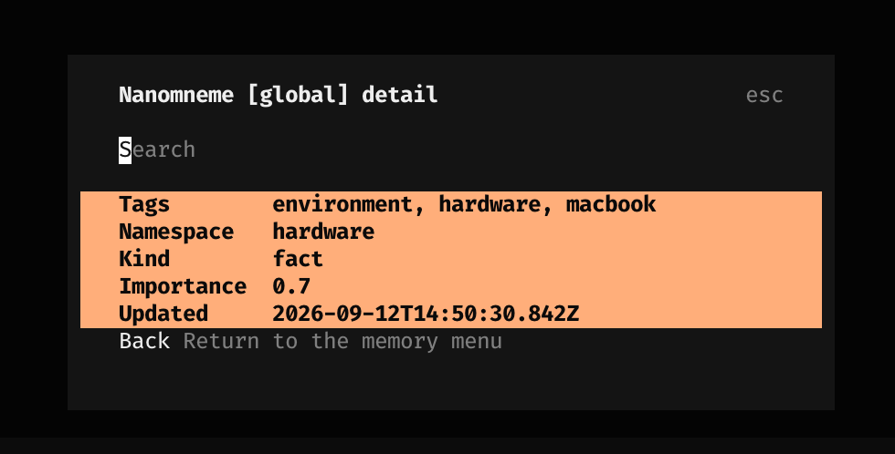

# @openlines/nmnm-opencode

Native evidence covers OpenCode V1 1.19.0 and V2 2.3.0, with earlier V2 2.0.29 checks retained as historical evidence. Rendered checks cover navigation, mutations, location safety, and live TUI reload; model checks cover V2 context, recall continuation, post-compaction freshness, and concurrent child-session isolation. Remote-machine deployment and publication remain separate.

<div align="center">

[](https://www.npmjs.com/package/@openlines/nmnm-opencode) [](https://www.npmjs.com/package/@openlines/nmnm-opencode)

</div>

OpenCode adapter for [nanomneme](https://github.com/linellazatin/nanomneme): a server plugin that gives OpenCode native, observable memory tools backed by the shared nanomneme SQLite store, bounded transient memory-index injection during the session, and a model-free TUI memory browser. Memory is reusable across OpenCode, Pi, Claude Code, and other adapters; only the harness-facing surface differs.

## Features

- A native **server plugin** (`index.js`, delegating to `src/server-v1.js` or `src/server-v2.js`) registers `retain_memory`, `recall_memory`, `retrieve_memory`, and `remove_memory`. Bun-hosted calls use the short-lived Node bridge (`src/bridge.js`) for SQLite access. No additional MCP server or daemon is introduced. New retains record `metadata.source: "opencode"`; patches preserve existing source when metadata is omitted. Among memory tools, only retain creates missing stores; eligible opt-in compaction capture can also create the project store. Removal is soft; purge requires the core CLI or workbench.
- **Bounded transient injection:** optional autoretention guidance precedes pins and recent memories. V1 uses `experimental.chat.system.transform`; V2 uses the primary session context hook, resolving the session directory each time. V2 auxiliary title/generate requests have no additional memory hook; optional compaction capture uses a separate native hook. The next primary request receives a fresh index. `reinjection` stays inert; context is never persisted.
- A deterministic, model-free **management CLI** — `nmnm-opencode` (`status`, `list`, `search`, `show`, `pin`, `unpin`, `remove`).
- A model-free **terminal browser** on **ctrl+alt+m** provides Status/All/Project/Global, source cycling, pagination, pin/unpin, and confirmed soft removal. V1 uses a terminal-local bridge; V2 uses authenticated OpenCode RPC and the server's home/store paths. Location changes reject stale selections rather than mutating a different store.







### Project summaries and briefs

V1 uses additive compaction context and identified live completion; V2 uses the native prompt and ended event. The Node bridge validates/saves checkpoints through core, keeping SQLite outside Bun. Manual and automatic summaries share brief rendering.

| Capability | OpenCode behavior |
| --- | --- |
| Manual summaries | Use shared CLI JSON add/update/remove commands in the project |
| Compaction autosummaries | Default-off `summary.autocapture.enabled`; valid matching live output saves with OpenCode source/receipt; missing, invalid or opaque output skips capture, and retention guidance controls model omission |
| Briefs | Independently enable `brief.enabled` for primary-request context delivery within existing budgets |

No extra inference or transcript reads. See the [overview and matrix](../../README.md#project-summaries-and-startup-briefs), [native capture lifecycle](docs/OPENCODE_ADAPTER_MANUAL.md#automatic-compaction-checkpoints) and [manual JSON contract](../../docs/CORE_CLI_MANUAL.md#project-work-summaries-and-briefs).

## Install

Registry examples use the published package; use local checkout loading below for unpublished changes. Manifests and lockfiles define dependency requirements. Root-only security overrides do not propagate to registry installations or Bun-managed caches; the upstream dependency fixes remain pending.

Use Node.js 22.19+ with built-in SQLite/FTS5 on the server's `PATH` (or `NMNM_NODE`). The unchanged package engine floor is 22.13 with FTS5 required separately, but the tested stock 22.13.0 binary lacks FTS5 and is unsuitable. Earlier adapter suites passed on 22.19.0 and 26.11.1; historical V2 2.3.0 live-provider checks used 26.13.0. The shared native/terminal CI matrix uses Node 22 without provider calls. Tested hosts do not certify every version accepted by the legacy API dependency. V1 receives compatibility fixes, not indefinite feature parity or an older-host guarantee.

### OpenCode V2

Configure the server in `opencode.json(c)`:

```jsonc
{ "$schema": "https://opencode.ai/config.json", "plugins": ["@openlines/nmnm-opencode"] }
```

OpenCode automatically loads the package's `./tui` entry from the connected server's plugin list. For an explicit terminal-local registration, use global `${XDG_CONFIG_HOME:-~/.config}/opencode/cli.json` with `{"plugins":["@openlines/nmnm-opencode"]}`; do not put terminal preferences in server configuration. Press **ctrl+alt+m**. Local development must use the adapter directory, such as `{"plugins":["/absolute/path/to/nanomneme/adapters/opencode"]}`, not `index.js` or `tui.js`. A remote server must have the server plugin enabled; the terminal browser never substitutes local persistence.

### OpenCode V1

Use singular `plugin` in the server configuration:

```jsonc
// opencode.json
{
  "$schema": "https://opencode.ai/config.json",
  "plugin": ["@openlines/nmnm-opencode"]
}
```

OpenCode installs npm plugins (and their dependencies) via Bun at startup and caches them.

### Enable the TUI browser

The TUI browser is a separate plugin entry from the server plugin. Register the same package in `~/.config/opencode/tui.jsonc`; OpenCode resolves the package's `./tui` export:

```jsonc
{ "plugin": ["@openlines/nmnm-opencode"] }
```

Restart OpenCode, then press **ctrl+alt+m** to open the model-free browser. It provides Status, All, Project, and Global tabs plus source filtering, pin/unpin, and confirmed soft removal.

For local development from this checkout, point the entry at the source instead:

```jsonc
{ "plugin": ["file:///absolute/path/to/nanomneme/adapters/opencode/index.js"] }
```

Register the TUI source separately in `~/.config/opencode/tui.jsonc`:

```jsonc
{ "plugin": ["file:///absolute/path/to/nanomneme/adapters/opencode/tui.js"] }
```

The four memory tools then appear natively to the agent. See the [OpenCode Adapter Manual](docs/OPENCODE_ADAPTER_MANUAL.md) for the full guide, including the compatibility probes and the manual smoke check.

For V1 rollback, select a previously verified compatible release from the changelog, use the same selection in both registrations, and restart. V2 support was introduced in adapter `0.3.0`; older adapters are not V2 rollback options. V2 may disable this plugin through its existing plugin configuration; no store migration is required in either direction.

## Configuration

- Project settings (shared across adapters): `<repo>/.nanomneme/nmnm.jsonc`.
- Global settings: `${XDG_CONFIG_HOME:-~/.config}/opencode/nmnm.jsonc`.
- Pins (adapter-owned): `<repo>/.nanomneme/nmnm-opencode.json` and `~/.local/share/nanomneme/nmnm-opencode.json`.

See the [OpenCode Adapter Manual](docs/OPENCODE_ADAPTER_MANUAL.md) for the config schema, tool reference, and injection lifecycle.

## Develop

The repository root temporarily overrides the legacy OpenCode plugin's Zod and Effect TOML dependencies to clear known denial-of-service advisories; exact selections live in the root manifest and lockfile. These overrides apply only when installing this checkout with npm; independently installed adapters and OpenCode's Bun-managed plugin caches do not inherit them. The adapter's tested host floor remains unchanged. Wait for an upstream plugin dependency fix before claiming clean independent installations, then remove the overrides and rerun adapter, native-host, audit, and standalone checks.

The browser RPC transport exposes only status, browse, detail, and pin/unpin/soft-removal operations through the connected OpenCode server. The server owns store routing and the Node bridge; the V2 client never falls back to local persistence. Reads retry only typed `rpc.unavailable` failures while location plugins load: at most 50 attempts, 100 ms apart, with disposal cancellation and origin checks. Mutations, authentication failures, and other transport errors are never retried; cancellation cannot roll back a dispatched synchronous mutation. Native checks are opt-in: set `NMNM_OPENCODE_V1` or `NMNM_OPENCODE_V2` to the native executable and run the corresponding `browser-rpc-v1-host.test.js` or `browser-rpc-host.test.js` under `adapters/opencode/test/`. Each uses isolated host state and disposable stores; unset hosts are explicitly skipped. See the manual for rendered and optional paid checks.

Core hardening introduced in `0.3.0` is covered through the real Node bridge for Unicode search/validation, invalid metadata/range operators, and private project/global first-use storage; direct handlers cover monotonic patch/restore timestamps under frozen/backward clocks. Tool-handler APIs are unchanged. Export/import/verification remain core CLI operations, not adapter tools.

```sh
node --test adapters/opencode/test/*.test.js
```

## Shared opt-in diagnostics

Diagnostics default off. Enable shared `logging.enabled` in `~/.local/share/nanomneme/config.jsonc`. User-level adapter settings can override it. Raw error messages are not redacted. See the [Logger manual](../../docs/LOGGER.md#configuration-and-record-contract) for configuration, record fields, permissions, and privacy boundaries.

OpenCode uses its existing user settings resolver under the OpenCode config directory. Node tool operations, CLI mutations, and confirmed TUI mutations are observed; index/navigation reads are unlogged. Each bridge process resolves settings anew. Spawn failures emit one host-side failed record because the bridge never ran; ambiguous post-spawn transport/parse failures remain unlogged to avoid contradicting a bridge outcome. Server tools forward the host tool-context `sessionID`; TUI and CLI management use null correlation.

Pin mutations use a same-directory lock and atomic replacement. Competing writers receive a retry error; locks are never reclaimed automatically. After a crash, stop all adapter writers, remove the affected pin file’s `.lock` manually, then retry.

`src/logslines.js` binds this adapter to core’s shared logging runtime; it does not contain a separate observer or generated bundle. See the [Logger manual](../../docs/LOGGER.md#source-and-artifact-map) for file roles and build rules.

## Project startup briefs

Set `brief.enabled` to true in the existing user/project `nmnm.jsonc` to include a deterministic project handoff through existing context delivery. Default is off; project false overrides user enablement. Use explicit summaries saved with `nmnm summary add --file summary.json` or eligible compaction autosummaries already saved in the project, then preview `nmnm brief`. No transcript ingestion, global brief store or separate model is involved. The brief uses space left by ordinary context. See [configuration, timing and limits](docs/OPENCODE_ADAPTER_MANUAL.md#project-startup-briefs).

To remove a brief source, use `nmnm summary remove <id> --json` with its project summary UUID. Briefs have no separate stored ID; the next configured refresh/reinjection or new session renders the remaining eligible summaries, or no brief when none remain. Already-injected context is unchanged.


Default-off [automatic compaction checkpoints](docs/OPENCODE_ADAPTER_MANUAL.md#automatic-compaction-checkpoints) use `summary.autocapture.enabled` independently of `brief.enabled`. V1/V2 append instructions to the existing compaction call and validate live completed output through the Node bridge. Missing/invalid/opaque output skips capture; no transcript read or extra model request occurs. Status reports native callback requirements and connected V2 availability.

Enabled project briefs can also include Pi native compaction checkpoints. The shared core labels that text historical/unverified and uses a complete recall pointer when full text exceeds the brief budget. Recall the project UUID for full detail; summary updates must preserve their original format.
